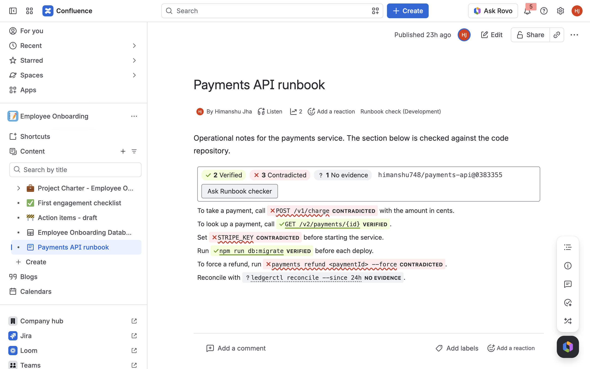

# The Page Is Lying

**Requires Confluence Cloud with Rovo.**

[Install on Confluence](https://developer.atlassian.com/console/install/49ffa6f4-93eb-41fb-8f2a-6a087aac4ac0?signature=AYABePL2xV9xjDb%2BabY%2FKJA8TaMAAAADAAdhd3Mta21zAEthcm46YXdzOmttczp1cy13ZXN0LTI6NzA5NTg3ODM1MjQzOmtleS83MDVlZDY3MC1mNTdjLTQxYjUtOWY5Yi1lM2YyZGNjMTQ2ZTcAuAECAQB4CxqLTo9l4lqXuFjNim1xJM%2Bp%2F3TVP9xHS2BrU5DRRucBJvE%2BVKNLIMGitmiSj4mo1AAAAH4wfAYJKoZIhvcNAQcGoG8wbQIBADBoBgkqhkiG9w0BBwEwHgYJYIZIAWUDBAEuMBEEDLx939ZsZeaijjKclgIBEIA75PYe66AVXchPBvFYZGZ6RpV2qg938MuNIm1YnNOnElpMmx%2FYysctVAqAcilhLPjAt1hq%2B02FG4bTUyIAB2F3cy1rbXMAS2Fybjphd3M6a21zOmV1LXdlc3QtMTo3MDk1ODc4MzUyNDM6a2V5LzQ2MzBjZTZiLTAwYzMtNGRlMi04NzdiLTYyN2UyMDYwZTVjYwC4AQICAHi9bVMAkme4qVQX1fQHo6ePw3H40A7cGfz7yrmSfBWMXgEulkTgaS9JUjTYO9cXswquAAAAfjB8BgkqhkiG9w0BBwagbzBtAgEAMGgGCSqGSIb3DQEHATAeBglghkgBZQMEAS4wEQQMfkteS1PqTPg5RzmrAgEQgDuvnEE0daVowBl1gRFACvqw4hbVNuTaanztMGjgJdsp6SmGqX6X8g1AS0U7787Lx9nBeFEYkNxkG8ws%2FgAHYXdzLWttcwBLYXJuOmF3czprbXM6dXMtZWFzdC0xOjcwOTU4NzgzNTI0MzprZXkvNmMxMjBiYTAtNGNkNS00OTg1LWI4MmUtNDBhMDQ5NTJjYzU3ALgBAgIAeDYASx0XCjkny4iLV6vz%2BKtEGSGT6kdt0QRpkn6D%2FlVEAU6KeoDU2JZ1u08L6bYqHukAAAB%2BMHwGCSqGSIb3DQEHBqBvMG0CAQAwaAYJKoZIhvcNAQcBMB4GCWCGSAFlAwQBLjARBAwwuh7aFba8s9D5yb8CARCAO%2Bnt4UNPgS3hrZOF8iMbxRnJj6Hm7Vz5mGk6%2BTLKRDBKLP4egurBHNOtoG9zgtNBz1ZrqfSSgCj4Yv%2FLAgAAAAAMAAAQAAAAAAAAAAAAAAAAAHZ7D8%2B%2FqGvAYC%2FDXNOCexb%2F%2F%2F%2F%2FAAAAAQAAAAAAAAAAAAAAAQAAADKJjuA2IkucvsdF0rCWjg1qStMzoFHgDwYkMEBplMBdjoP%2B3A8ISh1Yp1lWf4MVnMRlryC7m9ZOJqynX3y%2Bp00Yqx8%3D&product=confluence).
You need to be an administrator on a Confluence Cloud site.

**Runbooks go stale when nobody checks them against the code.**

The Page Is Lying checks Confluence runbook claims against a repository and
cites the file and line behind each verdict. Check a section with the macro,
a whole page from its byline, or a space from the drift view.

The same check, run against three public repositories and their own docs, is
written up in [Public repository checks](docs/real-world/README.md). One
documented flag is contradicted. The other two repositories' documented
routes, flags, and Python requirement match the code.

## How it uses Atlassian

Forge connects Confluence to the repository index. Rovo calls the same check
service as the macro, and Atlassian MCP exposes read-only tools for checking
pages and explaining or fixing claims. The verdict comes from the code index.
The tools are `check-page`, `check-claim`, `explain-claim`, `suggest-fix`, and `audit-space`.

## Quickstart

From a fresh clone with Node 22 or newer, try the checker in your browser:

~~~sh
npm ci && npm run demo
~~~

The local demo runs the real checker on the bundled payments fixture. Apply the
sample route correction and check how the verdict and source line change.
Try the catch-all example to see why a frontend fallback leaves a removed API
route without evidence.
For the live Forge and Rovo flow, install with the link above and
[open the sample runbook](docs/setup.md#judge-setup).

### Checks judges can reproduce

- **Public repositories.** Replay checks against pinned commits of
  `http-server`, JSON Server and Flask. The checker finds an incorrect flag
  spelling and verifies JSON Server's routes and Flask's Python requirement.
  [Run the public repository checks](docs/real-world/README.md#run-the-three-public-examples).
- **Confluence and MCP.** Start with the sample runbook and compare the five
  external calls against their expected results.
  [Open the five-call checklist](docs/agent-eval.md#3-mcp-server-fresh-install-checklist).

[Video](https://www.youtube.com/watch?v=GAsxA1YAr-4) ·
[Devpost](https://devpost.com/software/the-page-is-lying) · [MIT](LICENSE)

[Architecture](docs/architecture.md) · [Setup and MCP](docs/setup.md) ·
[Public repository checks](docs/real-world/README.md) ·
[Verification](docs/integration-results.md) · [Privacy](PRIVACY.md)
