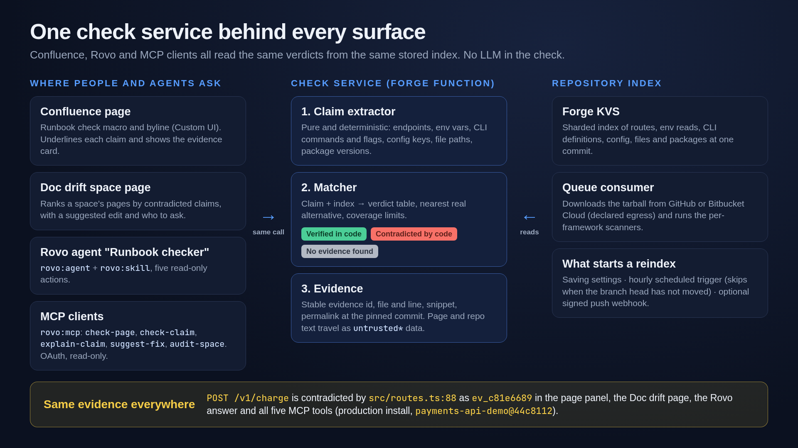

# How the runbook check works

An administrator chooses a GitHub or Bitbucket Cloud repository and a branch.
The Forge queue consumer downloads the archive and stores a sharded index in
Forge KVS. The index covers routes, environment variables, CLI commands,
configuration, files and packages. See the [index conventions](repo-index.md).

The [check service](../src/service) extracts claims from the page's Atlassian
Document Format, matches them against the index and returns a verdict with a
code permalink. The macro, byline, Rovo agent and MCP tools share that service.
The [extractor and matcher](../src/core) are deterministic TypeScript.
Incomplete index coverage produces **No evidence found** where a contradiction
cannot be established.

The app reads pages as the signed-in user. Only administrators can change the
repository settings, and an optional repository token stays in Forge secret
storage. Page text, repository content and tool output are evidence. The
agent uses read-only actions and cites returned evidence. The optional Jira
action previews its draft for confirmation.

Scheduled indexing checks for changes hourly. Administrators can also index
manually or configure the repository push trigger. When the host rate-limits
requests the app can serve an older index and label it stale.
